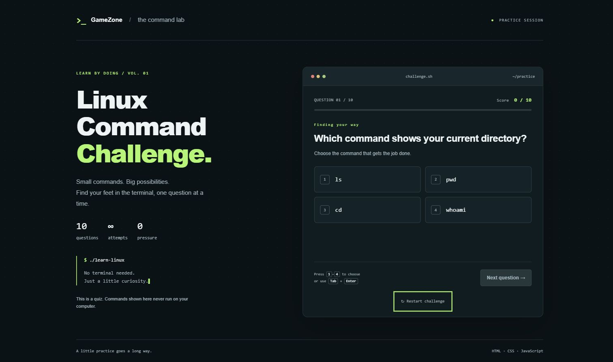

# Linux Command Challenge

A browser quiz for practicing ten everyday Linux commands: `pwd`, `ls`, `cd`,
`mkdir`, `touch`, `cat`, `cp`, `mv`, `rm`, and `grep`.

## How to play

Open `index.html` in a browser. No installation, server, account, or internet
connection is required for the game itself.

1. Choose one of four commands for each question.
2. Read the immediate feedback and explanation. The correct command is highlighted
   and each question can only be scored once.
3. Select **Next question**, then **View results** after question ten.
4. Review your score, percentage, and all answers on the results screen.
5. Use **Restart challenge** at any time, or **Play again** after finishing.

Use the mouse, touch, or the **1–4** keys to answer. All buttons also support
**Tab**, **Shift+Tab**, **Enter**, and **Space**. After answering, focus moves to
the next button; press **Enter** to continue. Feedback is announced through an
ARIA live region. Progress indicates the number of questions answered.

Commands are examples only and are never executed. Restarting or refreshing resets
the session; scores are not stored or sent anywhere.

## Technology and files

- `index.html`: semantic structure, labeled progress, and quiz/results sections.
- `style.css`: responsive terminal-inspired layout and visible keyboard focus.
- `script.js`: ten questions, answer locking, feedback, scoring, review, and restart.

Built with HTML, CSS, and vanilla JavaScript; no dependencies or build step.

## Preview

Related issue: [kunjgit/GameZone#5266](https://github.com/kunjgit/GameZone/issues/5266).
